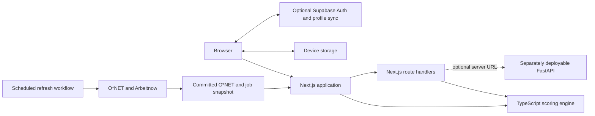

# Pivott

Don't predict the job. Map the tasks. Route the skills.

[](https://github.com/truffleloaf/Tudou-Pivott/actions/workflows/frontend.yml)
[](https://github.com/truffleloaf/Tudou-Pivott/actions/workflows/backend-tests.yml)

## Team Information

| Field | Details |
| --- | --- |
| **Team Name** | Tudou |
| **Team Domain** | Domain 1 — Aiversecity Future-Ready Workforce |
| **SDG Track** | SDG 8 — Decent Work and Economic Growth |
| **Team Leader** | Ho Xiang Ting |
| **University** | Xiamen University Malaysia |
| **Number of Members** | 2 |

## Project Links

| Resource | Link |
| --- | --- |
| **GitHub Repository** | [Tudou-Pivott](https://github.com/truffleloaf/Tudou-Pivott) |
| **Live Demo** | [Open Pivott on Replit](https://pivott.replit.app/workspace) |
| **RunPod Endpoint** | - |
| **Slide Deck** | [**Pitch deck (PDF):** [View on Google Drive](https://drive.google.com/file/d/1atC76KmzC__ldC8ABnpGl03yC5ITC6DP/view?usp=sharing)] |
| **Demo Video** | Demo on YouTube](https://youtu.be/rNJ4o8pxcAc?si=T8ILyeJXBZ-b-qx9) |

**Live demo:** [pivottstudio.vercel.app](https://pivottstudio.vercel.app)
**Replit Demo** [Open Pivott on Replit](https://pivott.replit.app/workspace) |


## What Pivott does

Pivott helps clerical and finance workers in Malaysia examine the tasks in their working week, compare adjacent roles and make a practical learning plan. Fresh graduates can start with work from study, placements or a sample profile. Scores come from versioned data and deterministic formulas; Pivott does not use an LLM to score a person or recommend a route.

## Domain 1 requirements

| Requirement | In the app | In the repository | Status and limit |
| --- | --- | --- | --- |
| Skills intake | [`/start`](https://pivottstudio.vercel.app/start), [`/skills`](https://pivottstudio.vercel.app/skills) | [`components/start`](web/components/start), [`lib/resume`](web/lib/resume) | Manual and local PDF/DOCX intake; demo profiles are synthetic and no real CV is stored. |
| AI trend signals | [`/signals`](https://pivottstudio.vercel.app/signals) | [`app/signals`](web/app/signals), [`backend/app/live/trends.py`](backend/app/live/trends.py) | Dated public sources and explicit assumptions; the current history is too short for a supported trend signal. |
| Future-role matching | [`/routes`](https://pivottstudio.vercel.app/routes) | [`lib/engine.ts`](web/lib/engine.ts) | Explainable fit bounds and scenarios; estimates do not make hiring decisions. |
| Reskilling pathway | [`/pathway`](https://pivottstudio.vercel.app/pathway) | [`app/pathway`](web/app/pathway), [`components/pathway`](web/components/pathway) | Rated gaps produce steps and estimated hours; an empty resource catalogue is shown honestly. |
| SDG mapping | [`/routes`](https://pivottstudio.vercel.app/routes), [`/pathway`](https://pivottstudio.vercel.app/pathway) | [`backend/app/data/sdg-map.json`](backend/app/data/sdg-map.json), [`docs/sdg-mapping.md`](docs/sdg-mapping.md) | All 17 goals are available; mappings are team judgement, not an official UN classification or measured impact. |
| Uncertainty | [`/map`](https://pivottstudio.vercel.app/map), [`/routes`](https://pivottstudio.vercel.app/routes) | [`lib/engine.ts`](web/lib/engine.ts), [`app/method`](web/app/method) | Slow, Normal and Fast scenarios expose assumptions; they are not forecasts. |

Pivott uses synthetic demo data and attributed public data. Recommendations link to their source where one exists. The app does not invent job listings, courses or statistics, and people remain responsible for career decisions. See the [Domain 1 verification record](docs/verification.md).

## How to run

Install Node.js 24 and pnpm 12.3.4, then run these commands from the repository root:

```bash
cd web
pnpm install --frozen-lockfile
pnpm dev
```

Open [http://localhost:3000](http://localhost:3000). The Next.js application includes its own route handlers, so the web app does not require FastAPI.

## Run the backend

FastAPI is optional and can be deployed separately for catalogue imports, PostgreSQL APIs and cross-engine checks.

```bash
cd backend
python -m venv .venv
.venv/bin/python -m pip install -r requirements.txt
PYTHONPATH=. .venv/bin/python -m uvicorn app.main:app --reload --port 8001
```

On Windows, use `.venv\Scripts\python.exe`. See the [backend README](backend/README.md) and [Render deployment guide](docs/deployment/render.md).

## Run all checks

Run from the repository root after installing the frontend and backend dependencies:

```bash
(cd web && pnpm lint && pnpm test && pnpm build)
(cd backend && PYTHONPATH=. .venv/bin/python -m pytest -q)
node scripts/data/generate-data.mjs --check
node scripts/checks/lint-copy.mjs
```

## How it fits together



Vercel serves one Next.js service, including `/api/*` route handlers. Guest work and job-alert preferences stay in device storage; optional Supabase sign-in syncs the profile. FastAPI is outside the Vercel project unless an operator deploys it separately and configures a server-side API base.

## Data sources and licences

| Source | Use | Terms |
| --- | --- | --- |
| [O*NET® 31.0 Database](https://www.onetcenter.org/database.html), U.S. Department of Labor, Employment and Training Administration | Occupations, tasks, skills and reported job titles | [CC BY 4.0](https://www.onetcenter.org/license_db.html). O*NET® is a trademark of the U.S. Department of Labor, Employment and Training Administration. |
| [Arbeitnow Job Board API](https://www.arbeitnow.com/blog/job-board-api) | Public job listings and relative demand in the dated snapshot | Public API; attribution and links return to the provider. |
| [United Nations Sustainable Development Goals](https://sdgs.un.org/goals) | Goal names and identifiers | The role and skill mappings are Pivott team judgement. |

The deployed catalogue is dated **24 October 2026**. It combines 10 imported O*NET occupations with 10 reviewed occupations that use the same O*NET release and scoring method: **20 roles, 100 tasks, 18 skills, 3 scenarios and 17 SDGs**. The dated Arbeitnow snapshot contains **347 matched listings**. The scheduled [`refresh-live.yml`](.github/workflows/refresh-live.yml) workflow refreshes public data on a reviewable branch.

The built-in demo is separate: **8 roles, 39 tasks, 15 skills, 20 signals, 25 learning resources, 3 scenarios and 17 SDGs**, dated **1 October 2026**. Aisyah and her ratings are fictional. See [SDG mapping](docs/sdg-mapping.md) for the editorial method.

## Responsible AI and limits

- Exposure measures potential task assistance or automation, not the probability of losing a job.
- Scenario scores, learning hours and role fits are estimates rather than predictions.
- O*NET describes United States occupations and Arbeitnow mainly lists jobs in Germany, which limits relevance to Malaysian workers.
- People choose their tasks, ratings, route and learning plan; Pivott does not make hiring decisions.
- Résumé files are read in the browser, reviewed by the user and discarded; the demo contains no real CVs.
- Job listings come from the public feed and may expire. Pivott does not process applications.
- The public API has no application authentication or rate limiter. Hosting-edge controls are required before broader API use.

## Repository map

| Path | Purpose |
| --- | --- |
| [`web/`](web) | Next.js web app, route handlers, deterministic engine and frontend tests |
| [`backend/`](backend) | Optional FastAPI service, importer, Python engine and backend tests |
| [`docs/`](docs) | Product evidence, data notes, screenshots and verification records |
| [`scripts/`](scripts) | Data generation, repository checks and browser verification |
| [`supabase/`](supabase) | Web account-sync migrations and email template |
| [`.github/workflows/`](.github/workflows) | Frontend, backend and public-data refresh automation |
| [`vercel.json`](vercel.json) | Single-service Next.js deployment configuration |

## Documentation

Use the [documentation index](docs/README.md) to find architecture, data, deployment, verification and backend references.

